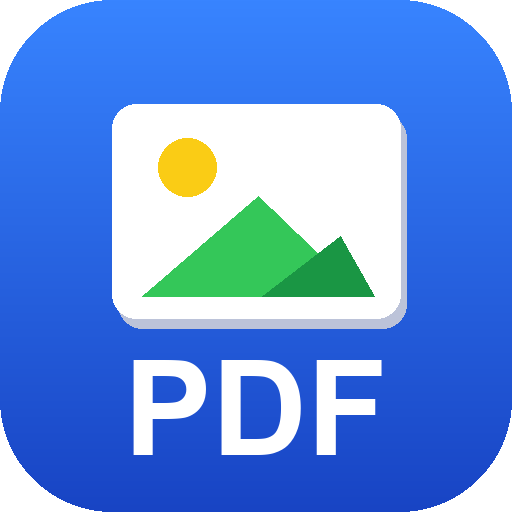

# PDF 转图片工具 (pdf2img)

<p align="center">
  
</p>

一个**完全离线**的 PDF → 图片转换工具，带图形界面，双击即用。
适合把扫描件、合同、报告、申请函等 PDF 转成方便发送和存档的图片。

**Offline PDF-to-image desktop tool with a GUI** — convert PDF pages to
single images or one merged long image, with selectable DPI. No network, no upload.

---

## 功能

- 🖱️ **图形界面**：双击打开，选文件 → 选模式 → 选清晰度 → 点确定，四步完成
- 📄 **两种输出模式**
  - **单页**：每页一张图（`文件名_p1.png`、`文件名_p2.png` …）
  - **合并长图**：所有页纵向拼成一张长图（`文件名_长图.png`）
- 🔍 **五档清晰度**：150 / 200 / 300 / 400 / 600 DPI
- 🖼️ **两种格式**：PNG（无损） / JPG（体积小）
- ✨ **扫描件无损导出**：整页就是一张图的扫描件，自动按**原始像素**提取，不做二次重采样
- 🔒 **完全离线**：不联网、不上传、不含任何统计代码
- ⌨️ **命令行模式**：支持批处理与自动化
- ⚡ **不卡界面**：转换在后台线程执行，实时进度条

## 环境要求

- Windows 10 / 11
- Python 3.9+（**需为官方安装版，自带 tkinter**）
- 依赖：`PyMuPDF`、`Pillow`

## 快速开始

### 方式一：直接运行源码

```bash
pip install -r requirements.txt
python pdf2img_gui.py
```

### 方式二：打包成 exe

```bash
pip install pyinstaller
python build.py
```

产物在 `dist/PDF转图片工具/`，双击其中的 `PDF转图片工具.exe` 运行。

> ⚠️ **重要**：不要单独把 exe 拖出来用，它必须与同目录的 `_internal` 文件夹在一起。

> 💡 **为什么用 one-dir 而不是 onefile？**
> tkinter 会拖进约 1000 个 tcl/tk 小文件，onefile 每次启动都要逐个解压。
> 本项目实测：**onefile 启动 47 秒 vs one-dir 启动 1.5 秒（快约 31 倍）**。
> 代价是产物从单文件变成一个约 78MB 的文件夹——为可用性值得。

## 使用说明

| 步骤 | 说明 |
|------|------|
| 1. 选择 PDF | 点「浏览…」选取文件 |
| 2. 输出模式 | **单页** / **合并长图** |
| 3. 清晰度 | 150 / 200 / **300（默认）** / 400 / 600 DPI |
| 4. 图片格式 | **PNG（无损）** / JPG |
| 5. 输出位置 | 默认 PDF 同目录下 `文件名_图片` 文件夹，可自定义 |
| 6. 开始转换 | 完成后可直接打开输出文件夹 |

### 清晰度怎么选

| 档位 | 适用场景 |
|------|---------|
| 草稿 150 DPI | 只看内容、随手预览，文件最小 |
| 标准 200 DPI | 屏幕阅读、微信发送 |
| **高清 300 DPI**（默认） | 通用推荐，文字清晰、体积可控 |
| 超清 400 DPI | 需要放大看细节 |
| 印刷级 600 DPI | 打印输出，文件可能很大 |

> 如果 PDF 是**扫描件**（整页就是一张图），程序会自动按**原始像素无损导出**，
> 此时 DPI 档位不影响画质，只影响普通（矢量/文字）页面的渲染。

## 命令行模式

```bash
# 单页，300 DPI，PNG，输出到 PDF 同目录
python pdf2img_gui.py --cli -i "报告.pdf" --mode single --dpi 300 --format png

# 合并长图，200 DPI，JPG，指定输出目录
python pdf2img_gui.py --cli -i "报告.pdf" -o "D:\输出" --mode merged --dpi 200 --format jpg

# 以 JSON 返回结果（便于程序读取）
python pdf2img_gui.py --cli -i "报告.pdf" --json
```

| 参数 | 说明 |
|------|------|
| `-i, --input` | 输入 PDF 路径（必填） |
| `-o, --output` | 输出目录（默认 PDF 同目录下 `<文件名>_图片`） |
| `--mode` | `single`（单页）/ `merged`（合并长图） |
| `--dpi` | 清晰度，默认 300 |
| `--format` | `png` / `jpg`，默认 `png` |
| `--json` | 以 JSON 输出结果 |

每次转换还会在输出目录写入 `_转换结果.json`，方便批处理程序读取。

## 常见问题

**Q：双击后没反应？**
确认 `PDF转图片工具.exe` 与 `_internal` 文件夹在同一目录。首次启动约 1~2 秒。

**Q：提示缺少 tkinter？**
请使用官方 Python 安装包（自带 tkinter）。部分精简版/商店版 Python 不含它。

**Q：合并长图很慢或内存吃紧？**
长图会把全部页面同时载入内存。页数很多时建议降低 DPI，或改用「单页」模式。
总像素超过约 4 亿时程序会弹窗提醒。

**Q：转换失败怎么办？**
程序会在用户目录生成 `pdf2img_error.log`，内含详细错误堆栈。

## 技术实现

- **界面**：tkinter（Python 标准库，零额外依赖）
- **PDF 渲染**：PyMuPDF（MuPDF 内核，渲染质量高、速度快）
- **图像处理**：Pillow
- **打包**：PyInstaller（one-dir 模式）

核心设计要点：

1. **扫描件无损路径**——通过 `page.get_images()` 判断整页是否就是一张图，
   若是则用 `doc.extract_image()` 直接取原始字节，绕过渲染重采样，画质零损失。
2. **巨图支持**——设置 `Image.MAX_IMAGE_PIXELS = None`，解除 Pillow 默认像素上限，
   以支持长图与 600 DPI 大图。
3. **内存保护**——合并长图前先零成本估算总像素，超过阈值时提示用户。
4. **响应式界面**——转换跑在后台线程，通过 `queue` 把进度回传主线程刷新 UI。

## 许可证

[MIT](LICENSE)